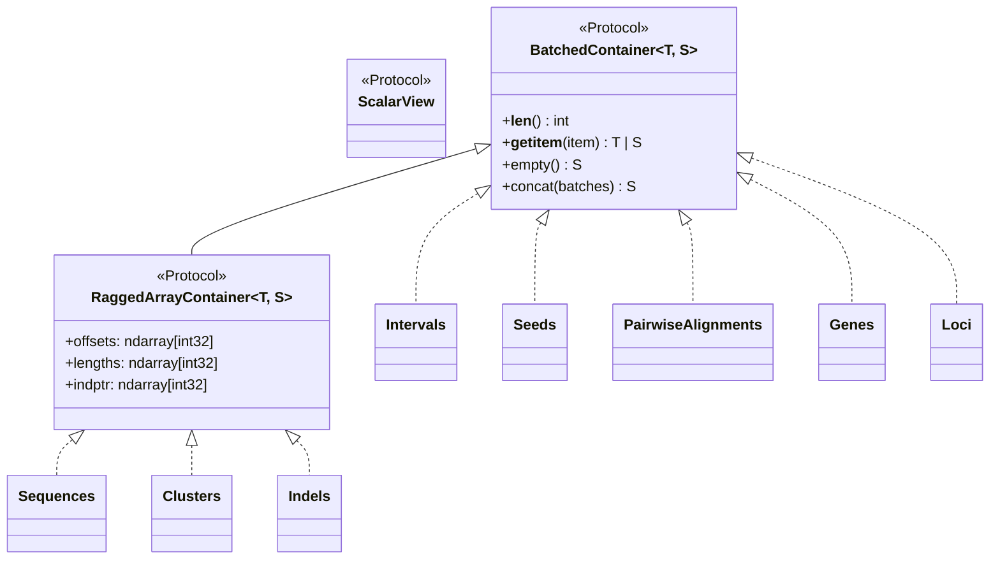

# Architecture & Algorithms

**SeroGen** is organized into three strictly layered packages designed for maximum throughput, vectorized memory locality, and zero external binary dependencies:

1. **[`serogen.core`](reference/core.md)** — Structure-of-Arrays (SoA) container protocols, sequence/alphabet kernels, k-mer/randstrobe indices, banded Smith-Waterman-Gotoh pairwise alignment, MCL/Leiden protein clustering, and bipartite graph alignment.
2. **[`serogen.genes`](reference/genes.md)** — Single-pass profile-HMM Viterbi ORF prediction (supporting bacterial, viral/prophage, and mycoplasma translation tables) and multi-scale 1D CNN functional role classification.
3. **[`serogen.loci`](reference/loci.md)** — Biosynthetic archetype ontologies, exact All-Contiguous-Partitions Dynamic Programming (ACP-DP) locus segmentation, cross-contig boundary stitching, and reference serotype matching.

---

## 1. Zero-Copy Structure-of-Arrays (`serogen.core`)

All batched biological entities in SeroGen implement [`BatchedContainer`][serogen.core.collections.BatchedContainer] or [`RaggedArrayContainer`][serogen.core.collections.RaggedArrayContainer] rather than storing Python lists of per-record objects:

- **Flat Contiguous Memory**: Variable-length sequences ([`Sequences`][serogen.core.seq.seq.Sequences]), orthogroup clusters ([`Clusters`][serogen.core.seq.clustering.Clusters]), and frameshift indels ([`Indels`][serogen.genes.models.Indels]) pack all elements into a single 1D NumPy buffer indexed by `offsets` and `lengths` (`int32`).
- **$O(1)$ Contiguous Views & Parallel Gathering**: Slicing a [`RaggedArrayContainer`][serogen.core.collections.RaggedArrayContainer] with a contiguous slice (`seqs[start:stop]`) returns a zero-copy NumPy view in $O(1)$ time; boolean masks or arbitrary index arrays dispatch to a parallel Numba gather kernel.
- **Lazy Scalar Views**: Indexing a single element (`genes[i]` or `loci[i]`) materializes an immutable `@dataclass(frozen=True, slots=True)` [`ScalarView`][serogen.core.collections.ScalarView] on demand.

---

## 2. Single-Pass Bacterial & Prophage ORF Calling (`serogen.genes`)

[`OrfPredictor`][serogen.genes.orf.predictor.OrfPredictor] combines global dicodon composition adaptation with a 29-state frameshift-aware Viterbi decoder:

1. **Precomputed 64-State Trinucleotide LUT**: [`Alphabet.DNA.encode`][serogen.core.seq.alphabet.Alphabet.encode] maps raw ASCII FASTA bytes into 2-bit integers (`0..3`) via a Numba LUT kernel, and builds a 1D array of 6-bit trinucleotide indices (`0..63`) shared across the Viterbi pass and downstream extraction passes.
2. **Global GC & Dicodon Adaptation**: Estimates GC content and 64-codon hexamer log-odds across long seed ORFs to adapt emission probabilities per genome.
3. **Frameshift-Aware Profile-HMM Viterbi**: Decodes forward and reverse coding states while modeling 1-bp/2-bp sequencing indels and Shine-Dalgarno RBS motifs upstream of candidate `ATG`/`GTG`/`TTG` starts.
4. **Single-Pass Viral/Prophage Rescue (`include_phage=True`)**:
   - Without running a second Viterbi pass, [`OrfPredictor.predict`][serogen.genes.orf.predictor.OrfPredictor.predict] scans unannotated gaps and out-of-frame operon regions (`-25 bp` to `+60 bp` overlap window for `TGATG` / `ATGA` translational coupling) using background-subtracted codon log-likelihoods (`coding_ll - noncoding_ll`) and local AT-enrichment scaling to recover horizontally acquired prophage ORFs, lysis cassettes, and small immunity proteins.

---

## 3. Multi-Scale 1D CNN Role Classification & Representation Extraction

[`GeneRoleClassifier`][serogen.genes.cnn.GeneRoleClassifier] maps translated amino-acid sequences into 30 functional [`GeneRole`][serogen.genes.roles.GeneRole] classes:

- **Architecture**: Learnable amino-acid embeddings followed by parallel 1D convolutional kernels (capturing local catalytic motifs, Rossmann folds, and transmembrane helices), global max-pooling, and a linear classification head.
- **Layer Sweep & Orthogroup Feature Extraction**: Beyond predicting 30 role probabilities (`predict_proba`), [`GeneRoleClassifier.transform`][serogen.genes.cnn.GeneRoleClassifier.transform] extracts intermediate post-convolution / pre-head representations that enrich downstream orthogroup clustering and GNN node embeddings.

---

## 4. Exact ACP-DP Locus Segmentation & Graph Alignment (`serogen.loci`)

1. **Candidate Island Detection**: [`LocusSegmenter`][serogen.loci.segmenter.LocusSegmenter] identifies biosynthetic gene islands enriched for core polysaccharide synthesis roles while tolerating interspersed IS elements/transposases.
2. **All-Contiguous-Partitions Dynamic Programming (ACP-DP)**: Evaluates contiguous sub-intervals against [`LocusArchetype`][serogen.loci.archetypes.LocusArchetype] completeness, anchor bonuses, and forbidden-role penalties (`CPS_WZY`, `CPS_ABC`, `CPS_SYNTHASE`, `O_AG_WZY`, `O_AG_ABC`, `WTA`, etc.).
3. **Cross-Contig Boundary Stitching**: Reconstructs fragmented loci split across draft assembly contig edges when boundary islands contribute complementary biosynthetic modules.
4. **Two-Stage Serotype Matching**:
   - **Stage 1 (Fast Vectorized Screening)**: Scores candidate serotypes by core-role Jaccard similarity, synteny conservation, and coverage-weighted amino-acid identity (resolving single-gene allelic variants such as *S. pneumoniae* `6A`/`6B` and `6C`/`6D`).
   - **Stage 2 (Bipartite [`GraphAligner`][serogen.core.graph.align.GraphAligner])**: Solves a minimum-cost Hungarian assignment over Weisfeiler-Lehman topological embeddings and [`LocusMatcher`][serogen.loci.matcher.LocusMatcher] node/edge costs to pinpoint exact gene gains, losses, and rearrangements.
