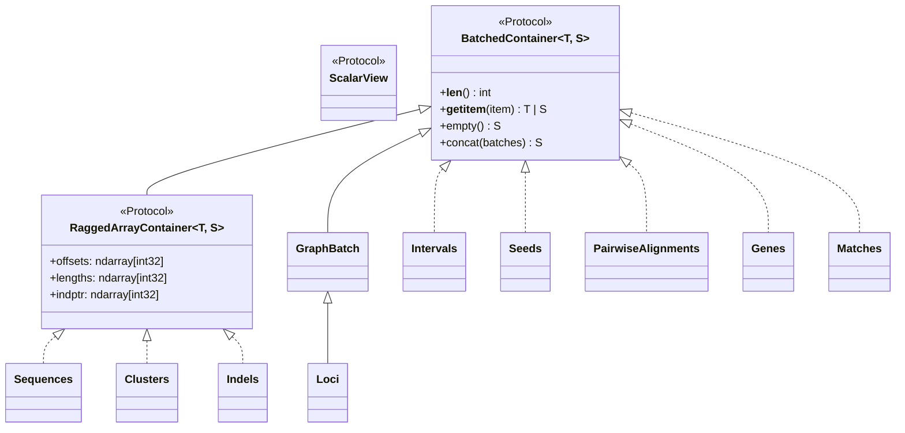

# Architecture & Algorithms

**SeroGen** is organized into three strictly layered packages designed for vectorized memory locality, biological sensitivity in the sequence twilight zone, and zero external CLI dependencies:

1. **[`serogen.core`](reference/core.md)** — Zero-copy Structure-of-Arrays (SoA) container protocols, sequence/alphabet kernels, `RandstrobeIndex` and `MMSEQS12` k-mer indices, banded/unbanded Smith-Waterman-Gotoh pairwise alignment (`PairwiseAligner`), hybrid CNN-rescued Markov Clustering (`Clusterer`), and graph-based data structures & solvers (`GraphModel`, `GraphBatch`, `GraphAligner`, `maximum_spanning_arborescence`, `RelationalMPNN`, `LayoutEngine`).
2. **[`serogen.genes`](reference/genes.md)** — Single-pass 29-state frameshift- and operon-overlap-aware profile-HMM Viterbi ORF prediction (`OrfPredictor`, supporting bacterial, viral/prophage, and alternative translation tables) and polysaccharide-antigen-specific multi-scale 1D-CNN + biophysical protein role classification (`GeneRoleClassifier`).
3. **[`serogen.loci`](reference/loci.md)** — Biosynthetic locus archetype ontologies (`LocusArchetype`), exact All-Contiguous-Partitions Dynamic Programming (ACP-DP) + multi-locus Viterbi segmentation (`LocusSegmenter`), MGE insertion bridging/healing, cross-contig boundary stitching (`LocusPredictor`), and de novo database construction & structural variant matching (`LocusMatcher`).

---

## 1. Zero-Copy Structure-of-Arrays (`serogen.core.collections` & `serogen.core.seq`)

All batched biological entities in SeroGen implement [`BatchedContainer`][serogen.core.collections.BatchedContainer] or [`RaggedArrayContainer`][serogen.core.collections.RaggedArrayContainer] rather than storing Python lists of per-record objects:

- **Flat Contiguous Memory**: Variable-length sequences ([`Sequences`][serogen.core.seq.seq.Sequences]), orthogroup clusters ([`Clusters`][serogen.core.seq.clustering.Clusters]), and frameshift indels ([`Indels`][serogen.genes.models.Indels]) pack all elements into a single 1D NumPy buffer indexed by `offsets` and `lengths` (`int32`).
- **$O(1)$ Contiguous Views & Parallel Gathering**: Slicing a [`RaggedArrayContainer`][serogen.core.collections.RaggedArrayContainer] with a contiguous slice (`seqs[start:stop]`) returns a zero-copy NumPy view in $O(1)$ time; boolean masks or arbitrary index arrays dispatch to a parallel Numba gather kernel.
- **Lazy Scalar Views**: Indexing a single element (`genes[i]` or `loci[i]`) materializes an immutable `@dataclass(frozen=True, slots=True)` [`ScalarView`][serogen.core.collections.ScalarView] on demand.

---

## 2. Single-Pass 29-State Bacterial & Prophage ORF Calling (`serogen.genes.orf`)

[`OrfPredictor`][serogen.genes.orf.predictor.OrfPredictor] combines sliding local GC adaptation with an unconditional 29-state frameshift- and operon-overlap-aware profile-HMM Viterbi decoder:

1. **Precomputed 64-State Trinucleotide LUT**: [`Alphabet.DNA.encode`][serogen.core.seq.alphabet.Alphabet.encode] maps raw ASCII FASTA bytes into 2-bit integers (`0..3`) via a Numba LUT kernel, and builds a 1D array of 6-bit trinucleotide indices (`0..63`) shared across the Viterbi pass and downstream extraction passes.
2. **Sliding 4-kb Prefix-Sum Local GC Adaptation**: Computes a 4-kb local GC bin (`0..43`) at every nucleotide via $O(1)$ prefix sums so codon log-odds adapt seamlessly across AT-rich polysaccharide islands and integrated prophages (`34%–44%` GC) embedded inside higher-GC host chromosomes.
3. **29-State Frameshift & Operon-Overlap Profile-HMM**:
   - Models forward and reverse coding phases alongside 12 explicit frameshift indel states (`1-bp` and `2-bp` insertions/deletions) to read through sequencing errors and frameshifted pseudogenes (`IS_FRAMESHIFT`) without splitting the ORF.
   - Models direct `1-bp` (`TGATG`/`TAATG`) and `4-bp` (`ATGA`) translational coupling overlaps via dedicated stop-to-start transitions (`E → M1` and `Er → M1r`), scored by upstream Shine-Dalgarno RBS binding energy and start-codon context.
4. **Single-Pass Viral/Prophage Rescue (`include_phage=True`)**:
   - Without running a second Viterbi pass, [`OrfPredictor.predict`][serogen.genes.orf.predictor.OrfPredictor.predict] scans unannotated gaps and out-of-frame operon regions (`-25 bp` to `+60 bp` overlap window) using background-subtracted codon log-likelihoods (`coding_ll - noncoding_ll`) and local AT-enrichment scaling to recover seroconverting bacteriophage cassettes (*gtrABC*, *oac*) and short phage accessory ORFs (`90–120 bp`).

---

## 3. Polysaccharide-Specific 1D-CNN Gene Classification (`serogen.genes.cnn`)

Why does SeroGen use a domain-specific neural architecture ([`GeneRoleClassifier`][serogen.genes.cnn.GeneRoleClassifier]) instead of `BLAST`, `MMseqs2`, or generic profile HMMs?

- **Breaking the Sequence Twilight Zone (`< 20–25%` Identity)**: In bacterial surface polysaccharide loci (`CPS`, `O_AG`, `WTA`, `EPS`), diversifying selection drives `Wzx` flippases (`FLIPPASE`), `Wzy` polymerases (`POLYMERASE`), `WaaL` ligases (`LIGASE`), and glycosyltransferases (`GLYCOSYLTRANSFERASE`) into extreme sequence divergence where k-mer seeding and alignment bitscores fail, even though catalytic triads (`DxD`, `ED`, `EX7E`), Rossmann `GxGxxG` dinucleotide-binding loops, and transmembrane hydropathy profiles remain strictly conserved.
- **Multi-Scale 1D-CNN + 20-D Biophysical Head**:
  1. Learnable amino-acid embeddings (`embed_dim=64`) feed three parallel 1D convolutional branches (`num_filters=192`, `kernel_size=(3, 5, 9)`) with LUT-factored forward and backward Numba kernels (`_conv1d_dual_pool_Lut_forward` / `_conv1d_dual_pool_lut_backward`).
  2. Dual global max-pooling (`conv_max`, isolating peak catalytic motif activations regardless of sequence length) and length-normalized mean-pooling (`conv_mean`, capturing domain composition) are concatenated with a **20-dimensional biophysical descriptor vector** (`12`-class `Alphabet.MMSEQS12` frequencies + Kyte-Doolittle hydropathy mean/std, transmembrane helix fraction, net charge, pI proxy, aromaticity, tiny/bulky ratio, and log-length).
  3. Z-score standardization and a linear head classify proteins across **29 functional [`GeneRole`][serogen.genes.roles.GeneRole]s**, rejecting low-confidence non-polysaccharide proteins as open-set `GeneRole.UNKNOWN` (`Role 29`).
- **Active-Site Representations (`transform`)**: [`GeneRoleClassifier.transform`][serogen.genes.cnn.GeneRoleClassifier.transform] exposes 8 internal representation layers (`embed_mean`, `embed_max`, `conv_max`, `conv_mean`, `pooled`, `features_norm`, `task_weighted`, `logits`) used directly by [`Clusterer`][serogen.core.seq.clustering.Clusterer] for twilight-zone homology rescue.

---

## 4. Smart Hybrid Sequence Clustering & MCL (`serogen.core.seq.clustering`)

[`Clusterer`][serogen.core.seq.clustering.Clusterer] (`src/serogen/core/seq/clustering.py`) groups proteins into non-redundant orthogroups ([`Clusters`][serogen.core.seq.clustering.Clusters] ragged SoA container with zero-copy `.as_csr()` membership matrices) through a 4-stage hybrid pipeline:

1. **Fast Exact & Strobemer Seeding**: Deduplicates identical sequences via 64-bit `FNV-1a` hashes ([`Sequences.unique`][serogen.core.seq.seq.Sequences.unique]), builds syncmer-linked [`RandstrobeIndex`][serogen.core.seq.kmers.RandstrobeIndex] lookup tables, and aligns candidate pairs with SIMD-parallel banded Smith-Waterman-Gotoh ([`PairwiseAligner`][serogen.core.seq.pairwise.PairwiseAligner]).
2. **Reduced-Alphabet `MMSEQS12` Diagonal Prefilter & Intra-Role Evaluation**: In sensitive/MCL mode, builds a $12^4 = 20,736$-bucket CSR inverted index of `Alphabet.MMSEQS12` 4-mers (`_build_mmseqs12_k4_csr`), scores ungapped BLOSUM62 diagonals (`_mmseqs12_k4_ungapped_prefilter`), and evaluates intra-role pairs via unbanded Smith-Waterman-Gotoh so divergent homologs sharing a [`GeneRole`][serogen.genes.roles.GeneRole] are aligned even when they share zero exact k-mers.
3. **Role-Gated CNN Motif-Embedding Rescue**: When `embeddings` from [`GeneRoleClassifier.transform(seqs, layer="conv_max")`][serogen.genes.cnn.GeneRoleClassifier.transform] are provided, pairs sharing the same `GeneRole` with active-site cosine similarity $\ge \tau_{\text{motif}}$ (`motif_rescue_threshold=0.75`) are rescued down to `15%` sequence identity and their cosine similarity is blended (`embedding_weight`) into the alignment bitscore graph.
4. **Compiled Graph Clustering Kernels**:
   - **`mode="mcl"` (Markov Cluster Algorithm)**: Runs a Numba-compiled sparse MCL solver (`_mcl_cluster`) with column-wise top-$K$ pruning, stochastic random-walk expansion, and inflation ($I = 2.0$) on BLOSUM62 + motif-rescued bitscores to resolve natural functional orthogroups.
   - **`mode="cdhit"` / `"greedy_cover"` / `"upgma"` / `"connected_components"`**: Length-descending greedy incremental clustering (`_cdhit_cluster`) for fast reference redundancy reduction (`<= 80%` identity), greedy set cover, average-linkage UPGMA, or transitive connected components.

---

## 5. Graph-Based Data Structures & Solvers (`serogen.core.graph`)

Every biosynthetic locus and pan-locus database in SeroGen is modeled as a directed attributed graph in [`serogen.core.graph`](reference/core.md):

- **Bit-Packed 32-Bit Nodes & Edges ([`models.py`][serogen.core.graph.models])**:
  - [`IntNode`][serogen.core.graph.models.IntNode] and [`BitField`][serogen.core.graph.models.BitField] pack multi-attribute biological descriptors into primitive `uint32` integers for zero-allocation array operations. [`GeneNode`][serogen.loci.models.GeneNode] packs `CLUSTER_ID` (16 bits), `ROLE_ID` (6 bits), `STRAND` (1 bit), `IS_FRAMESHIFT` (1 bit), and `TAG_EDGE` (bit 31); [`IntergenicType`][serogen.loci.models.IntergenicType] packs `ORIENTATION` (2 bits: co-directional, convergent, divergent) and `GAP_BIN` (4 bits, including contig-break bin `14`).
  - [`GraphModel`][serogen.core.graph.models.GraphModel] provides `.as_graph(as_bipartite=..., symmetrize=...)`, normalized Laplacian eigenvalue spectra (`.laplacian_spectrum()`), and topological Wasserstein-1 Earth Mover's distance (`.spectral_distance()`).
  - [`GraphBatch`][serogen.core.graph.models.GraphBatch] (the base class of [`Loci`][serogen.loci.models.Loci]) stores thousands of variable-size graphs in flat contiguous SoA arrays (`node_types`, `node_offsets`, `edge_sources`, `edge_targets`, `edge_types`, `edge_offsets`) with parallel Numba slicing (`_slice_graph_batch_kernel`), block-diagonal CSR generation, all-vs-all Wasserstein distance matrices, and **`.as_pan_graph(node_mask=...)`** to compress a batch of loci into a unified directed consensus pan-locus network.
- **Weisfeiler-Lehman + Hungarian Bipartite Graph Alignment ([`align.py`][serogen.core.graph.align])**:
  - [`GraphAligner`][serogen.core.graph.align.GraphAligner] combines pluggable semantic node/edge cost matrices ([`LocusNodeCostStrategy`][serogen.loci.matcher.LocusNodeCostStrategy], [`ExactMatchCostStrategy`][serogen.core.graph.align.ExactMatchCostStrategy]) with continuous Weisfeiler-Lehman neighborhood smoothing ([`WeisfeilerLehmanEmbedding`][serogen.core.graph.align.WeisfeilerLehmanEmbedding]) and Hungarian minimum-cost assignment (`scipy.optimize.linear_sum_assignment`).
- **Directed Spanning Arborescences & Constrained $K$-Best Enumeration ([`arborescence.py`][serogen.core.graph.arborescence])**:
  - [`maximum_spanning_arborescence`][serogen.core.graph.arborescence.maximum_spanning_arborescence] and [`minimum_spanning_arborescence`][serogen.core.graph.arborescence.minimum_spanning_arborescence] implement an iterative stack-based Chu-Liu/Edmonds optimum branching solver in $O(N^2)$ time for unconstrained 2D graphs, and automatically switch to a compiled Numba branch-and-bound solver (`_branch_and_bound_k_best`) with regret-ordered vertex branching and suffix upper-bound pruning when 3D `(N, N, S)` slot/valence exclusivity (`slot_exclusivity=True`) or `edge_groups` constraints are active.
  - [`k_best_arborescences`][serogen.core.graph.arborescence.k_best_arborescences] enumerates the top-$K$ highest-scoring valid directed spanning trees in descending order.
- **Numba Relational Message-Passing Neural Network ([`gnn.py`][serogen.core.graph.gnn])**:
  - [`build_multihop_csr`][serogen.core.graph.gnn.build_multihop_csr] constructs an 8-relation incoming-edge [`RelationalCSR`][serogen.core.graph.gnn.RelationalCSR] (self-loops, 1-hop codirectional forward/reverse, 1-hop convergent/divergent, 2-hop forward/reverse, and per-graph virtual global pool nodes).
  - [`RelationalMPNN`][serogen.core.graph.gnn.RelationalMPNN] executes parallel `@njit` forward and backward relational message passing with RMSNorm, clamped-node residual anchor injection (`clamped_mask`), a node classification head, a factorized bilinear multi-channel directed edge/slot scoring head (`bilinear_edge_scores_forward`), and differentiable log-space [`sinkhorn_bipartite_matching`][serogen.core.graph.gnn.sinkhorn_bipartite_matching].
- **Visualization Coordinate Layout Utility ([`layout.py`][serogen.core.graph.layout])**:
  - [`LayoutEngine`][serogen.core.graph.layout.LayoutEngine] is a lightweight Numba Fruchterman-Reingold and spectral layout utility that computes 2D/3D node coordinates for plotting [`GraphModel`][serogen.core.graph.models.GraphModel] and [`GraphBatch`][serogen.core.graph.models.GraphBatch] pan-graphs.

---

## 6. De Novo Polysaccharide Locus Discovery & Database Matching (`serogen.loci`)

[`LocusPredictor`][serogen.loci.predictor.LocusPredictor] and [`LocusSegmenter`][serogen.loci.segmenter.LocusSegmenter] discover surface polysaccharide loci *de novo* directly from unannotated genomes — even when disrupted by mobile elements or split across draft contigs:

1. **Candidate Island Detection & MGE Bridging**: [`LocusSegmenter`][serogen.loci.segmenter.LocusSegmenter] identifies genomic islands enriched for polysaccharide biosynthesis, processing, and transport roles while bridging across interspersed mobile genetic elements (`GeneRole.TRANSPOSASE` and `GeneRole.INTEGRASE`, such as `IS5` insertions inside *K. pneumoniae* `KL106`) and tolerating atypical `UNKNOWN` gaps inside extended operons (such as `KL107`).
2. **All-Contiguous-Partitions Dynamic Programming (ACP-DP) & Multi-Locus Viterbi**: Evaluates contiguous sub-intervals against 11 [`LocusArchetype`][serogen.loci.archetypes.LocusArchetype] definitions (`CPS_WZY`, `CPS_ABC`, `CPS_SYNTHASE`, `O_AG_WZY`, `O_AG_ABC`, `O_AG_SYNTHASE`, `WTA`, `LTA`, `EPS`, `LOS_CORE`, `PGA`) using [`ArchetypeClassifier`][serogen.loci.classifier.ArchetypeClassifier] log-odds scoring, anchor boundary snapping, and forbidden-role penalties, partitioning tandem loci (e.g., adjacent `K` and `O` operons) cleanly.
3. **MGE Excision/Healing & Cross-Contig Boundary Stitching**:
   - Calling `LocusPredictor(heal_mobile_elements=True)` (or [`Locus.heal_mobile_elements()`][serogen.loci.models.Locus.heal_mobile_elements]) excises `TRANSPOSASE`/`INTEGRASE` insertions and reconnects flanking biosynthetic genes in the locus graph.
   - Calling `LocusPredictor(stitch_contig_splits=True)` detects partial biosynthetic modules located near contig boundaries (`edge_margin=5000 bp`), re-orients reverse-complemented contigs, merges split partial ORFs across the break (`GAP_BIN = 14`), and reconstructs the complete locus (`is_fragmented=True`).
4. **De Novo Database Construction & Vectorized Structural Variant Matching ([`LocusMatcher`][serogen.loci.matcher.LocusMatcher])**:
   - Given any collection of de novo-discovered [`Loci`][serogen.loci.models.Loci], [`LocusMatcher`][serogen.loci.matcher.LocusMatcher] clusters their proteins via [`Clusterer`][serogen.core.seq.clustering.Clusterer] (`cluster_mode="mcl"` or `"cdhit"`), indexes the centroids with [`RandstrobeIndex`][serogen.core.seq.kmers.RandstrobeIndex], and executes a parallel Numba kernel (`_match_loci_kernel`) that scores gene-cluster Jaccard/Dice similarity, collinear synteny conservation, and amino-acid identity while classifying exact structural differences into composable [`MatchType`][serogen.loci.matcher.MatchType] bitflags (`EXACT`, `STRAND_VARIANT`, `MGE_VARIANT`, `FRAMESHIFT_VARIANT`, `SYNTENY_VARIANT`, `GENE_VARIANT`, `ROLE_VARIANT`, `ARCHETYPE_MISMATCH`, `FRAGMENTED_VARIANT`).
