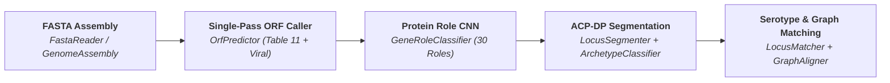

# SeroGen

<div class="serogen-hero" markdown>

# SeroGen

**High-performance genomic analysis, de novo polysaccharide locus segmentation, and *in silico* serotyping.**

Built on zero-copy Structure-of-Arrays (SoA) containers and parallel Numba JIT kernels, **SeroGen** transforms raw bacterial or prophage genome assemblies into fully annotated biosynthetic gene clusters and high-precision serotype calls in tens of milliseconds — with zero external command-line dependencies (`minimap2`, `prodigal`, or `diamond` are not required).

<div class="serogen-badges">
  
  
  
  
  
</div>

</div>

---

## Key Capabilities

<div class="grid cards" markdown>

-   :lucide-zap: **Single-Pass Bacterial & Prophage ORF Calling**

    ---

    Decodes bacterial chromosomes (`~70 ms` for a 4.66 Mb *E. coli* genome; **>65 Mb/s**) using a profile-HMM Viterbi decoder with frameshift tolerance, Shine-Dalgarno RBS scoring, and single-pass viral/prophage gap rescue ([`OrfPredictor`][serogen.genes.orf.predictor.OrfPredictor]).

-   :lucide-cpu: **Multi-Channel 1D CNN Role Classification**

    ---

    Classifies translated protein sequences across **30 biosynthetic, regulatory, transport, and mobile genetic element (MGE) roles** via a multi-scale 1D convolutional neural network compiled to pure NumPy/Numba ([`GeneRoleClassifier`][serogen.genes.cnn.GeneRoleClassifier]).

-   :lucide-waypoints: **Exact ACP-DP Locus Segmentation**

    ---

    Partitions chromosomes into discrete capsule (`CPS`), O-antigen (`O_AG`), wall teichoic acid (`WTA`), and ectopic synthase islands using exact All-Contiguous-Partitions Dynamic Programming and cross-contig boundary stitching ([`LocusSegmenter`][serogen.loci.segmenter.LocusSegmenter]).

-   :lucide-git-compare: **Randstrobe + Gotoh + Bipartite Graph Matching**

    ---

    Indexes orthogroup clusters with [`RandstrobeIndex`][serogen.core.seq.kmers.RandstrobeIndex], aligns candidates via SIMD-parallel banded Smith-Waterman-Gotoh ([`PairwiseAligner`][serogen.core.seq.pairwise.PairwiseAligner]), and resolves structural variants with Hungarian bipartite [`GraphAligner`][serogen.core.graph.align.GraphAligner].

</div>

---

## End-to-End Pipeline



---

## Quickstart

=== "De Novo Locus Prediction"

    ```python
    from serogen.core.genome import GenomeAssembly
    from serogen.loci.predictor import LocusPredictor

    # Load a bacterial genome assembly (single or multi-contig FASTA)
    assembly = GenomeAssembly.from_fasta("genome.fasta")

    # Predict ORFs (bacterial + embedded prophages), classify gene roles, and segment loci
    predictor = LocusPredictor()
    loci = predictor.predict(assembly)

    for locus in loci:
        print(
            f"{locus.archetype.name}: {locus.start}..{locus.end} "
            f"({len(locus.genes)} genes, completeness={locus.completeness:.2f})"
        )
    ```

=== "Single-Pass Bacterial & Prophage ORF Calling"

    ```python
    from serogen.core.io.fasta import FastaReader
    from serogen.genes.orf.predictor import OrfPredictor

    with open("CP014225.1.fasta", "rb") as fh, FastaReader(fh) as reader:
        contigs = reader.load()

    # Predict standard bacterial ORFs alongside atypical/overlapping prophage ORFs in one pass
    predictor = OrfPredictor(include_phage=True)
    genes = predictor.predict(contigs)

    print(f"Predicted {len(genes):,} ORFs across {len(contigs)} contig(s)")
    proteins = genes.translations
    ```

=== "Reference Database Matching & Graph Alignment"

    ```python
    from serogen.loci.matcher import LocusMatcher

    matcher = LocusMatcher(reference_loci)

    # Match segmented query loci against reference serotypes
    matches = matcher.match(loci)
    best = matches[0]
    print(f"Best call: {best.target_name} (score={best.score:.3f}, AA identity={best.mean_aa_identity:.1%})")

    # Perform detailed node-by-node bipartite synteny alignment
    alignment = matcher.align(loci[0], best.target_index)
    ```

---

## Performance Summary

| Pipeline Stage | Engine | Throughput / Latency (`4.66 Mb` *E. coli* K-12) |
| :--- | :--- | :--- |
| **2-Bit DNA Encoding** | [`Alphabet.DNA.encode`][serogen.core.seq.alphabet.Alphabet.encode] | **`0.38 ms`** (`12.2 GB/s` via Numba LUT) |
| **Ragged Protein Translation** | [`GeneticCode.translate_ragged`][serogen.core.seq.alphabet.GeneticCode.translate_ragged] | **`0.61 ms`** (`4,968` CDSs) |
| **Bacterial ORF Prediction** | [`OrfPredictor(include_phage=False)`][serogen.genes.orf.predictor.OrfPredictor] | **`59.6 ms`** (`78.1 Mb/s`) |
| **Single-Pass Bacterial + Phage ORFs** | [`OrfPredictor(include_phage=True)`][serogen.genes.orf.predictor.OrfPredictor] | **`70.9 ms`** (`65.7 Mb/s`) |
