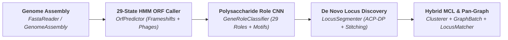

<div class="serogen-hero" markdown>

# SeroGen

**De novo bacterial polysaccharide antigen locus discovery, twilight-zone CNN gene role classification, hybrid MCL orthogroup clustering, and graph-based pan-locus analysis.**

Built on zero-copy Structure-of-Arrays (SoA) containers and parallel Numba JIT kernels, **SeroGen** transforms raw bacterial or prophage genome assemblies into annotated polysaccharide biosynthetic gene clusters, orthogroup pan-graphs, and de novo reference databases in milliseconds — with zero external command-line dependencies (`minimap2`, `prodigal`, `mmseqs2`, or `diamond` are not required).

<div class="serogen-badges">
  
  
  
  
  
</div>

</div>

---

## Core Innovations

<div class="grid cards" markdown>

-   :lucide-cpu: **Polysaccharide-Specific Dual-Head CNN (29 Roles + Phage Detection)**

    ---

    Surface antigen machinery (`Wzx` flippases, `Wzy` polymerases, `WaaL` ligases, and glycosyltransferases) routinely diverges below `20–25%` amino-acid identity where `BLAST`/`MMseqs2` fail. [`GeneRoleClassifier`][serogen.genes.cnn.GeneRoleClassifier] pairs multi-scale 1D convolutional motif filters (`k = 5, 9, 13 aa`; `DxD`, `ED`, `EX7E`, Rossmann loops) with dual `[conv_max, conv_avg]` pooling across **29 functional [`GeneRole`][serogen.genes.roles.GeneRole]s** (+ open-set `UNKNOWN` biological decoy rejection) and a joint **1-bit bacterial vs. bacteriophage/prophage origin head** (`predict_source` / `predict_source_proba`).

-   :lucide-boxes: **Smart Hybrid Clustering & CNN-Rescued MCL**

    ---

    [`Clusterer`][serogen.core.seq.clustering.Clusterer] pairs `FNV-1a` exact deduplication, [`RandstrobeIndex`][serogen.core.seq.kmers.RandstrobeIndex] strobemer seeding, `MMSEQS12` reduced-alphabet $12^4$ CSR + ungapped BLOSUM62 diagonal prefiltering, and SIMD-parallel Smith-Waterman-Gotoh ([`PairwiseAligner`][serogen.core.seq.pairwise.PairwiseAligner]) with **role-gated CNN active-site motif rescue** (`conv_max` cosine similarity) and compiled **sparse Markov Clustering (MCL)** (`mode="mcl"`) or greedy `CD-HIT` (`mode="cdhit"`).

-   :lucide-share-2: **Zero-Copy Graph Data Structures & Solvers**

    ---

    [`serogen.core.graph`](reference/core.md) provides 32-bit bit-packed [`IntNode`][serogen.core.graph.models.IntNode]s ([`GeneNode`][serogen.loci.models.GeneNode], [`IntergenicEdge`][serogen.loci.models.IntergenicEdge]), zero-copy CSR/SoA [`GraphBatch`][serogen.core.graph.models.GraphBatch] containers with `.as_pan_graph()` compression, Weisfeiler-Lehman + Hungarian [`GraphAligner`][serogen.core.graph.align.GraphAligner], Chu-Liu/Edmonds + constrained $K$-best [`maximum_spanning_arborescence`][serogen.core.graph.arborescence.maximum_spanning_arborescence], and Numba [`RelationalMPNN`][serogen.core.graph.gnn.RelationalMPNN].

-   :lucide-waypoints: **De Novo Fragmented & MGE-Tolerant Locus Discovery**

    ---

    [`LocusPredictor`][serogen.loci.predictor.LocusPredictor] and [`LocusSegmenter`][serogen.loci.segmenter.LocusSegmenter] discover `CPS`, `O_AG`, `WTA`, `LTA`, `EPS`, `LOS_CORE`, and `PGA` loci *de novo* without a reference database — decoding frameshifted ORFs and `1-bp`/`4-bp` operon overlaps ([`OrfPredictor`][serogen.genes.orf.predictor.OrfPredictor]), bridging/healing `IS` transposase/integrase insertions (`heal_mobile_elements=True`), and stitching loci split across draft contigs (`stitch_contig_splits=True`).

</div>

---

## End-to-End Architecture



---

## Quickstart

=== "De Novo Locus Discovery (Intact, MGE-Disrupted & Fragmented)"

    ```python
    from serogen.core.genome import GenomeAssembly
    from serogen.loci.predictor import LocusPredictor

    # Load a bacterial genome assembly (single chromosome or multi-contig draft FASTA)
    assembly = GenomeAssembly.from_fasta("genome.fasta")

    # Discover polysaccharide loci de novo, bridging IS elements and stitching contig splits
    predictor = LocusPredictor(stitch_contig_splits=True, heal_mobile_elements=False)
    loci = predictor.predict(assembly)

    for locus in loci:
        print(
            f"{locus.archetype.name}: {locus.start}..{locus.end} "
            f"({locus.num_genes} genes, completeness={locus.completeness:.2f}, "
            f"has_mge={locus.has_mge}, fragmented={locus.is_fragmented})"
        )
    ```

=== "Hybrid CNN-Rescued MCL Clustering & De Novo Database Construction"

    ```python
    from serogen.loci.matcher import LocusMatcher
    from serogen.loci.models import GeneNode, Loci

    # Build a de novo locus database from discovered loci using hybrid MCL clustering
    raw_db = Loci.from_list(discovered_loci).canonicalize_strands()
    matcher = LocusMatcher(raw_db, cluster_mode="mcl", min_identity=80.0, min_coverage=0.80)

    # Compress the clustered Loci (GraphBatch) into a directed consensus pan-locus CSR graph
    pan_adj, pan_nodes, pan_counts = matcher.targets.as_pan_graph(node_mask=GeneNode.mask("ROLE_ID", "CLUSTER_ID"))

    # Match new de novo query loci against the database and inspect MatchType variant bitflags
    matches = matcher.match(query_loci)
    best = matches[0]
    print(f"Best match: {best.target_name} (score={best.score:.3f}, flags={best.match_type!r}, is_novel={best.is_novel})")
    ```

=== "Single-Pass Bacterial & Prophage ORF Calling"

    ```python
    from serogen.core.io.fasta import FastaReader
    from serogen.genes.orf.predictor import OrfPredictor

    with open("CP014225.1.fasta", "rb") as fh, FastaReader(fh) as reader:
        contigs = reader.load()

    # Decode bacterial ORFs, frameshifted pseudogenes, 1-bp/4-bp overlaps, and prophage ORFs in one pass
    predictor = OrfPredictor(include_phage=True)
    genes = predictor.predict(contigs)

    print(f"Predicted {len(genes):,} ORFs ({int(genes.is_frameshift.sum())} frameshifted)")
    proteins = genes.translations
    ```

---

## Performance Summary

| Pipeline Stage | Engine | Throughput / Latency (`4.66 Mb` *E. coli* K-12) |
| :--- | :--- | :--- |
| **2-Bit DNA Encoding** | [`Alphabet.DNA.encode`][serogen.core.seq.alphabet.Alphabet.encode] | **`0.38 ms`** (`12.2 GB/s` via Numba LUT) |
| **Ragged Protein Translation** | [`GeneticCode.translate_ragged`][serogen.core.seq.alphabet.GeneticCode.translate_ragged] | **`0.61 ms`** (`4,968` CDSs) |
| **29-State Frameshift-Aware Bacterial ORFs** | [`OrfPredictor(include_phage=False)`][serogen.genes.orf.predictor.OrfPredictor] | **`59.6 ms`** (`78.1 Mb/s`) |
| **Single-Pass Bacterial + Prophage ORFs** | [`OrfPredictor(include_phage=True)`][serogen.genes.orf.predictor.OrfPredictor] | **`70.9 ms`** (`65.7 Mb/s`) |
